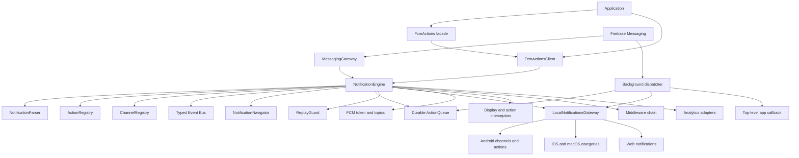

# Architecture

`fcm_actions` uses a static facade only for the common one-app experience. The
runtime itself is an owned, injectable object graph; registries, streams, and
platform adapters are not global singletons.



## Package layout

```text
lib/
  fcm_actions.dart
  fcm_actions_testing.dart
  src/
    actions/       action definitions and handlers
    channels/      channel registry
    core/          facade, client, engine, contracts, configuration
    handlers/      callback and object-oriented action handlers
    models/        Freezed/json_serializable immutable models
    navigation/    named-route mapping
    parser/        normalization and payload validation
    platform/      Firebase and local notification gateways
    services/      event bus, replay protection, durable retry queue
    utils/         narrowly scoped platform utilities
```

## Message flow

1. `MessagingGateway` receives an FCM message.
2. `NotificationParser` validates and normalizes notification, data, mixed,
   topic, condition, and silent payload shapes.
3. The engine emits a typed lifecycle event.
4. Non-silent foreground and data-only messages pass through display
   interceptors and the local notification gateway.
5. A tap/reply is normalized into `NotificationActionEvent`.
6. Replay protection claims the message/action identity.
7. Action interceptors and middleware run, followed by the registered handler
   and global callback.
8. Failures enter the bounded persistent retry queue.
9. Events and analytics adapters are notified without coupling them to action
   execution.

## Background isolates

Flutter background entry points cannot access main-isolate objects. The
dispatcher therefore persists only JSON-safe configuration, initializes
plugins in the isolate, invokes an optional top-level callback, and hands failed
or unhandled work back to the main isolate. Callback handles are validated at
initialization.

## Dependency injection

`NotificationEngine` accepts messaging and local-notification gateways, event
bus, registries, queue, and replay guard. Production defaults are provided, but
tests can replace every external boundary. `FcmActionsClient` owns and disposes
the engine; the facade merely delegates to one default client.
